# ShiftPilot
> Real-Time Dispatch & Field Operations Platform

[](LICENSE)
[](https://openjdk.org/projects/jdk/17/)
[](https://spring.io/projects/spring-boot)
[](https://www.postgresql.org/)
[](https://redis.io/)
[](https://react.dev/)

ShiftPilot is a real-time dispatch and field operations platform built for SMEs (delivery, field service, on-demand maintenance). It centralizes dispatch management, provides field workers with an instant task interface, and eliminates dispatch conflicts using event-driven WebSockets and optimistic locking.

---

## Visual Preview & Interface (Light & Dark Mode)

### Real-Time Dispatcher Console (Kanban Board)
| Light Mode | Dark Mode |
| :---: | :---: |
| 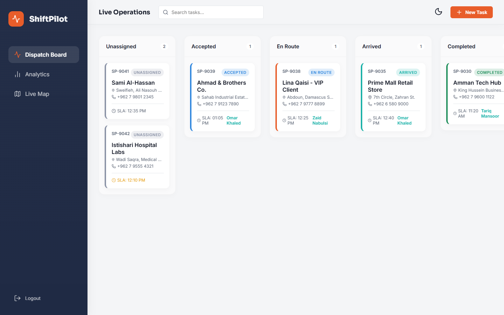 | 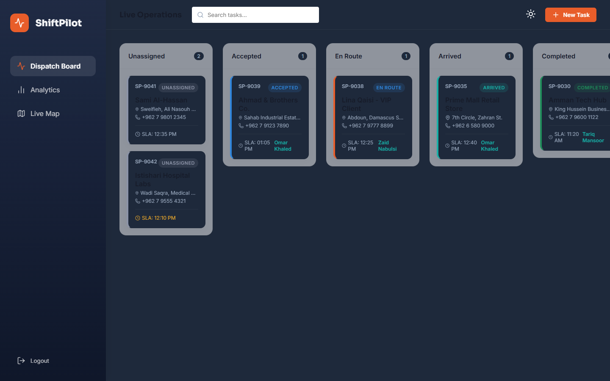 |

### Fleet Analytics & SLA Metrics
| Light Mode | Dark Mode |
| :---: | :---: |
| 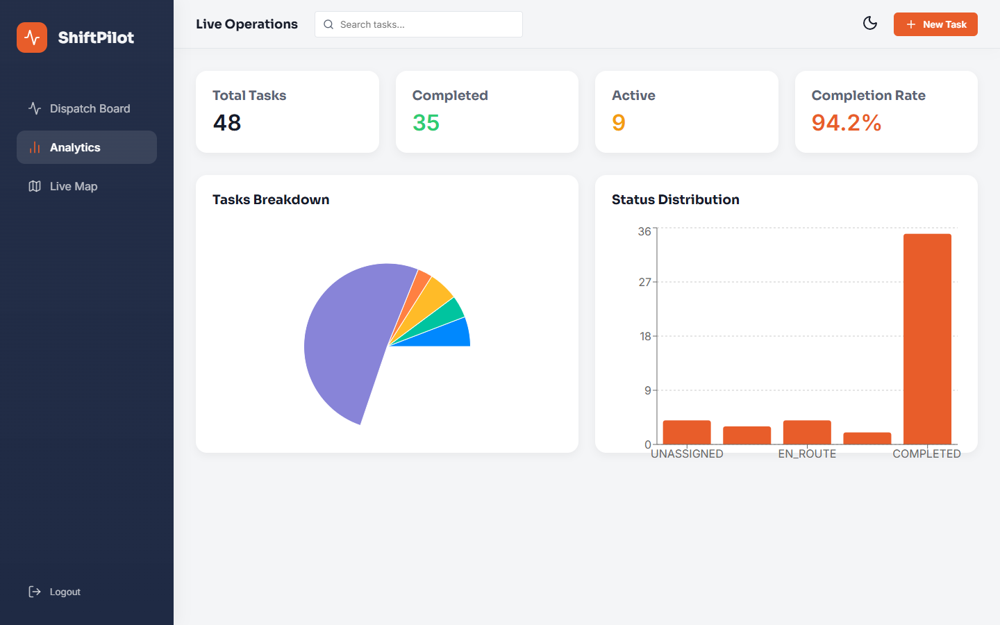 | 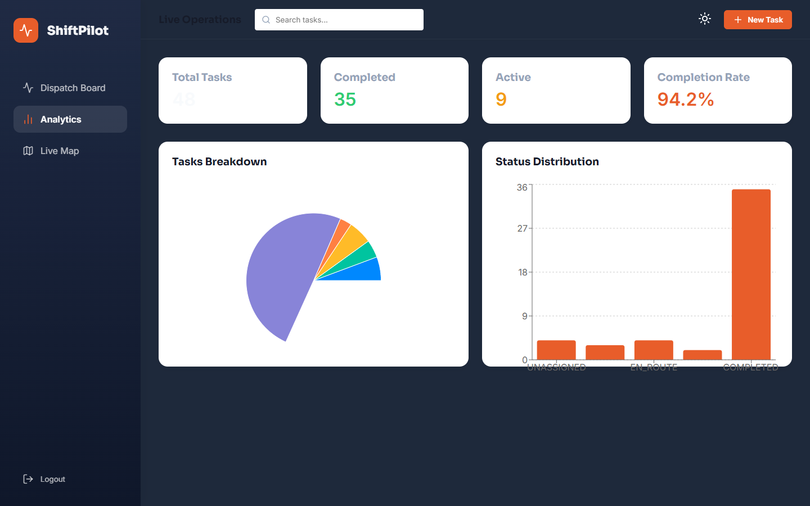 |

### Live Field Operations Map
| Light Mode | Dark Mode |
| :---: | :---: |
| 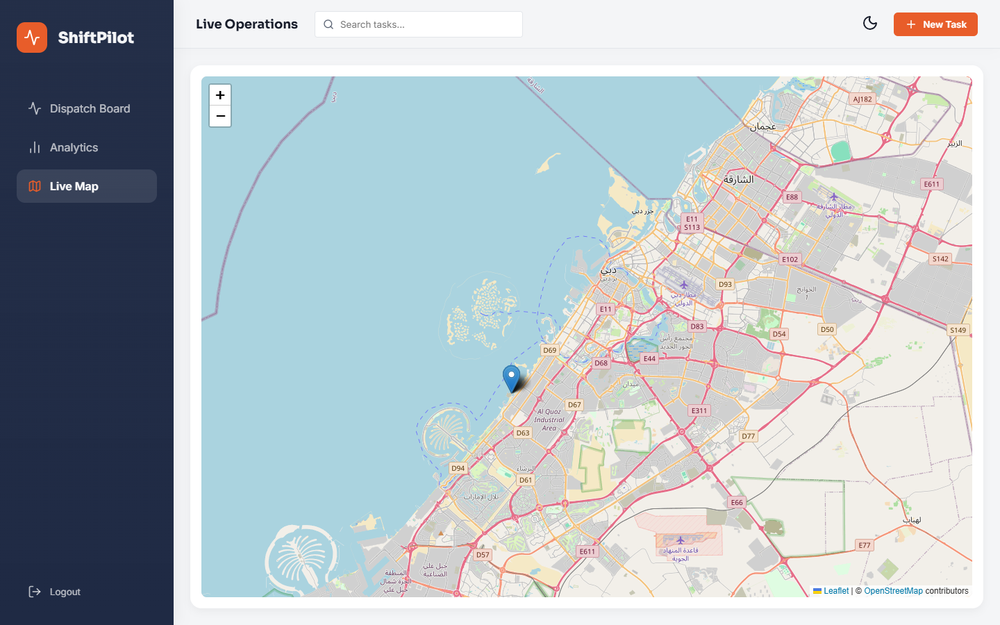 | 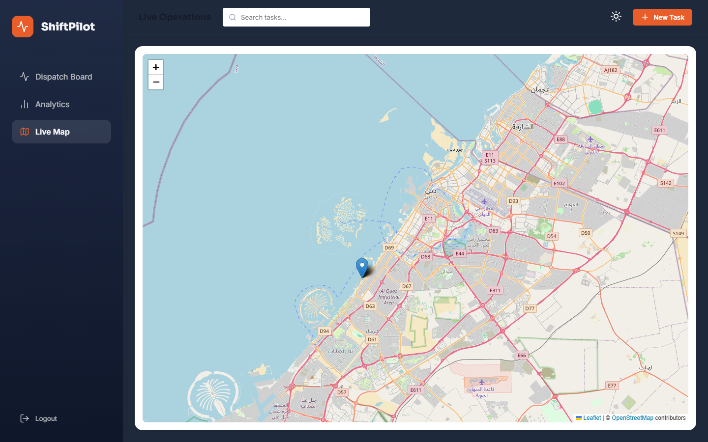 |

### Field Agent Mobile Task Interface
| Agent Route (Light) | Agent Route (Dark) |
| :---: | :---: |
| 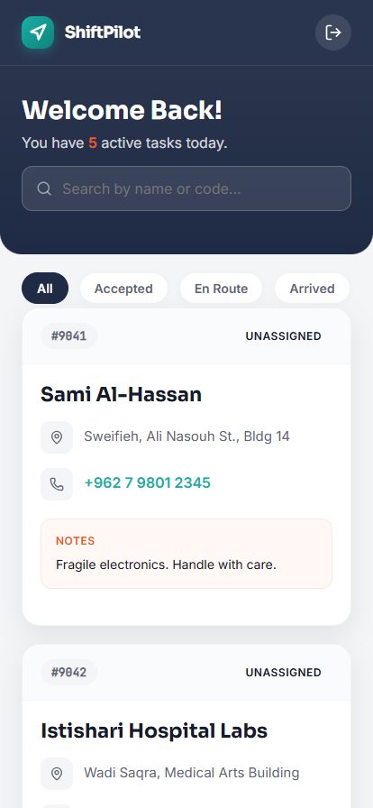 | 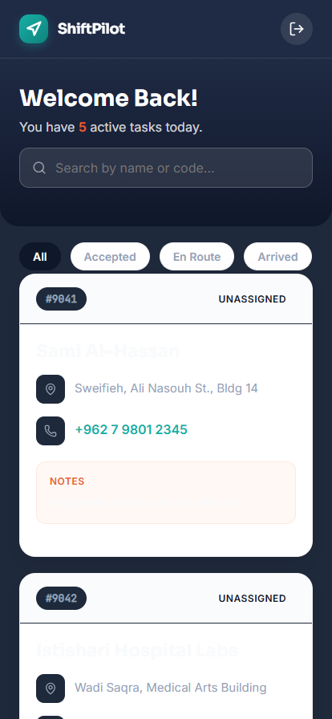 |

### Portal Authentication
| Dispatcher Login | Field Agent Mobile Login |
| :---: | :---: |
| 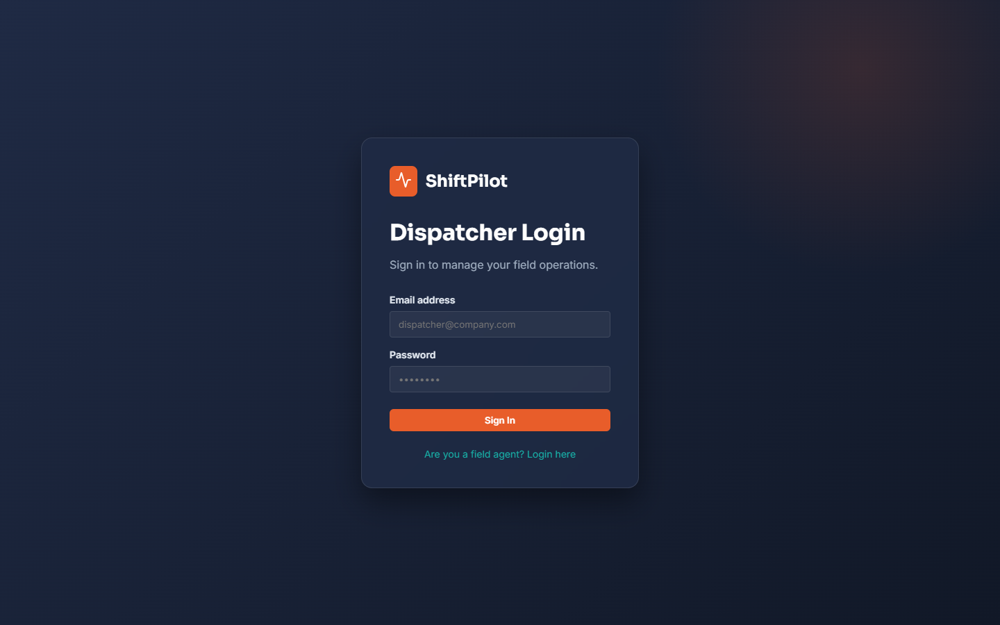 | 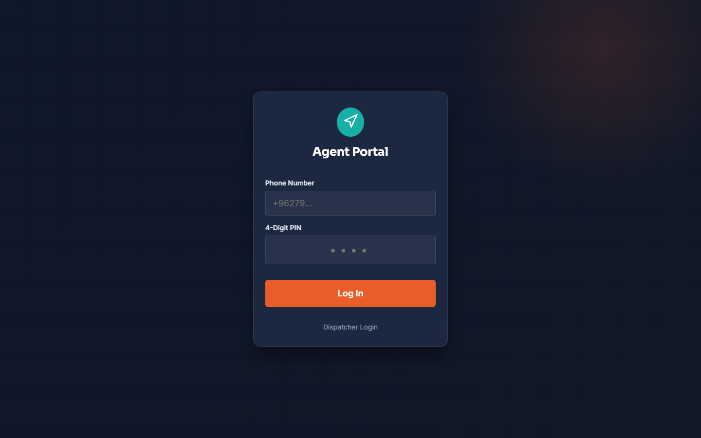 |

---

## Architecture

ShiftPilot uses an event-driven architecture decoupled across stateful WebSocket clients and stateless backend services via Redis Pub/Sub:

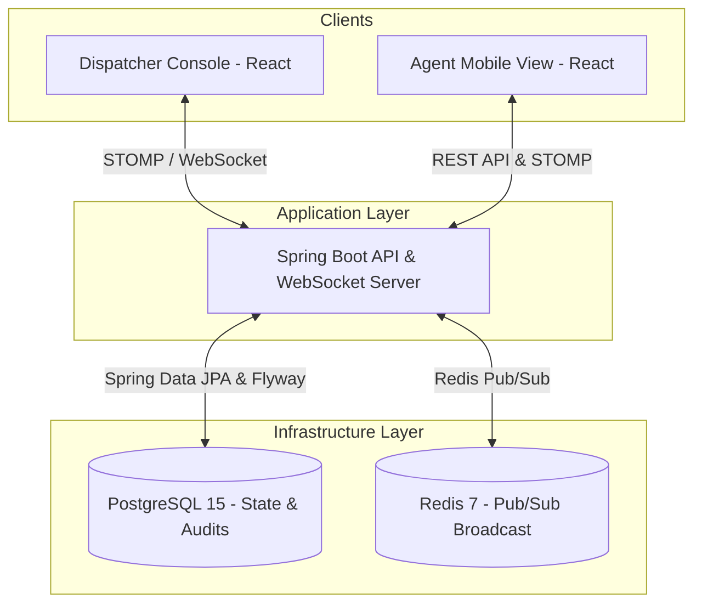

### Scalability Design
- **Redis Pub/Sub WebSocket Scaling**: When a status change occurs on an API instance, the event is published to Redis. All connected API instances subscribe to the channel and push the update to their connected WebSocket clients, enabling horizontal scaling without sticky sessions.
- **Optimistic Locking**: Task assignments use JPA `@Version` optimistic concurrency control to prevent duplicate dispatching in high-concurrency scenarios.

---

## Tech Stack

| Component | Technology | Rationale |
| :--- | :--- | :--- |
| **Backend** | Java 17, Spring Boot 3.2.3 | Type-safe enterprise framework for high-concurrency state transitions. |
| **Database** | PostgreSQL 15 | ACID guarantees, relational integrity, Flyway schema migrations. |
| **Real-time Layer** | WebSockets (STOMP), Redis 7 | Redis Pub/Sub enables horizontal scaling of the WebSocket notification layer. |
| **Frontend** | React 18, TypeScript, Vite | Single codebase serving both the desktop Dispatcher Console and mobile Agent View. |
| **UI & State** | Tailwind CSS, TanStack Query, Zustand | WebSocket-driven cache patching for live UI updates. |
| **Containerization** | Docker, Docker Compose | Multi-container local orchestration (Postgres, Redis, API, Frontend). |

---

## Features

- **Live Dispatch Kanban**: Real-time board updating task states without page reloads.
- **Agent Mobile View**: Streamlined interface for drivers and technicians to accept tasks and transition statuses (`ACCEPTED` -> `EN_ROUTE` -> `ARRIVED` -> `COMPLETED`).
- **Rule-Based Auto-Assignment**: Workload-balanced task distribution across available on-shift agents.
- **SLA Breach Monitoring**: Background jobs tracking deadlines and flagging at-risk tasks.
- **Concurrency Protection**: Optimistic locking preventing two dispatchers or agents from claiming the same task simultaneously.
- **Security**: BCrypt password hashing, role-based authorization (`DISPATCHER` vs `AGENT`), and JWT authentication.

---

## Getting Started

### Prerequisites
- [Docker & Docker Compose](https://www.docker.com/)
- Optional for manual dev: Java 17 SDK, Maven 3.9+, Node.js 18+

---

### Running Full Stack with Docker Compose

To start PostgreSQL, Redis, the Spring Boot API, and the React frontend with a single command:

```bash
docker compose up -d --build
```

- **Frontend Application**: http://localhost:5173
- **Backend API**: http://localhost:8080
- **Swagger / OpenAPI Documentation**: http://localhost:8080/swagger-ui/index.html (redirects from `/swagger-ui.html`)

---

## Demo Credentials (Seeded Data)

When starting in non-production profiles (`!prod`), the database automatically seeds demo users:

| Portal | Role | Username / Identifier | Password / PIN | Notes |
| :--- | :--- | :--- | :--- | :--- |
| **Dispatcher Console** | `DISPATCHER` | `dispatcher@fastdelivery.com` | `password123` | Desktop board to assign and monitor tasks |
| **Agent Mobile View** | `AGENT` | `+962790000001` | `1234` | Mobile interface to progress task lifecycle |

> **Testing Live Real-Time Sync Locally:**  
> Open two browser windows side by side (one logged in as Dispatcher at http://localhost:5173, and one logged in as Agent at http://localhost:5173/agent). When the agent taps **Accept** or **Complete**, watch the dispatcher's board update in real time via WebSockets!

---

## Environment Setup

The application reads configuration from environment variables with fallbacks specified in `backend/src/main/resources/application.yml`. See `.env.example` for the environment template:

```bash
cp .env.example .env
```

| Variable | Default Value | Description |
| :--- | :--- | :--- |
| `SPRING_DATASOURCE_URL` | `jdbc:postgresql://localhost:5432/shiftpilot` | JDBC connection string |
| `SPRING_DATASOURCE_USERNAME` | `shiftpilot` | PostgreSQL database user |
| `SPRING_DATASOURCE_PASSWORD` | `password` | PostgreSQL database password |
| `SPRING_DATA_REDIS_HOST` | `localhost` | Redis server hostname |
| `SPRING_DATA_REDIS_PORT` | `6379` | Redis port |
| `JWT_SECRET` | `(secure hex string)` | Key used to sign JWT authentication tokens |

---

## Database Migrations

Database schema versioning is managed via **Flyway**.
The baseline migration script is located at:
`backend/src/main/resources/db/migration/V1__init_schema.sql`

---

## Running Automated Tests

To run the unit test suite (covering Task lifecycle state transitions and concurrency assignment guards):

```bash
# In backend directory
mvn test
```

To run frontend production build checks:

```bash
cd frontend
npm run build
```

---

## Limitations / Not Yet Implemented

1. **Two-Browser Playwright E2E Test**: Automated end-to-end multi-context browser testing is not yet automated in CI; testing is currently performed via unit tests and side-by-side manual verification.
2. **AWS Cloud Infrastructure**: The architecture is designed for AWS deployment (ECS Fargate, RDS PostgreSQL, ElastiCache Redis), but is currently run and tested locally via Docker Compose.
3. **GPS Routing & Live Map**: Geolocation tracking and turn-by-turn route optimization algorithms are planned roadmap features and are not implemented in the current release.
4. **Offline PWA Sync**: The agent mobile view requires active network connectivity; offline IndexedDB queuing is on the roadmap.
